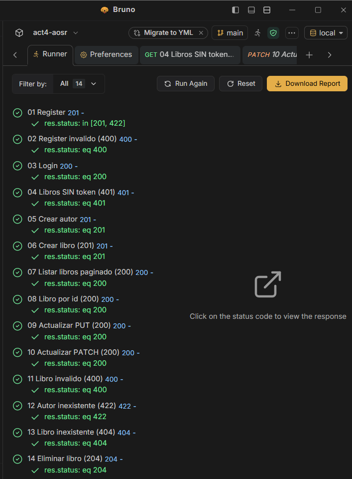
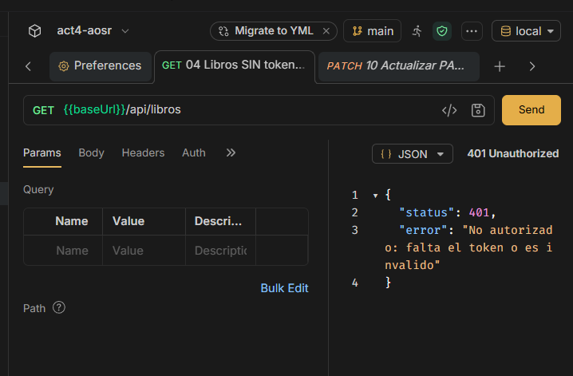
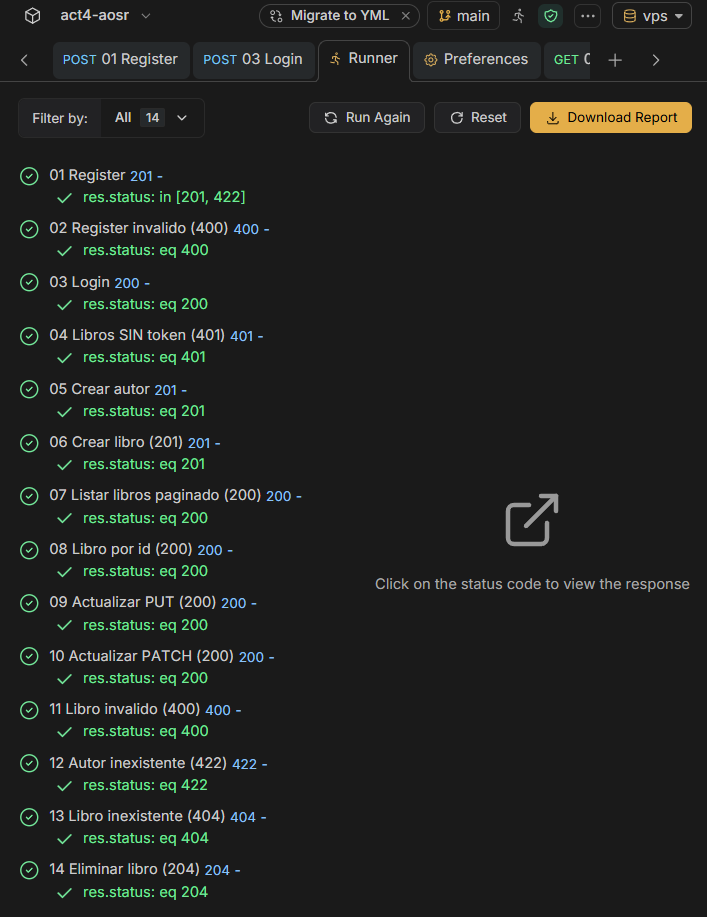
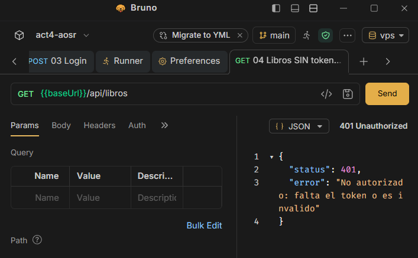

# Actividad 4: API REST con Spring Security y JWT

**Alumno:** Ángel Omar Santos Ríos (AOSR) · **GitHub:** [23161146](https://github.com/23161146)
**Curso:** Programación Web · **Tema 4:** Spring Boot

API REST pura (sin vistas) para gestionar **libros y autores**, con registro e inicio de sesión reales mediante **JWT**. Los endpoints del CRUD solo responden si la petición trae un token válido. Retoma el modelo Autor-Libro de la Actividad 3 y le agrega seguridad, validación, paginación y manejo uniforme de errores.

## Enlaces

| Recurso | URL |
|---|---|
| Repositorio | https://github.com/23161146/AOSRact4_t4 |
| API desplegada (base) | http://oaxacoders.tech:9093/api |
| Registro | `POST` http://oaxacoders.tech:9093/api/auth/register |
| Login | `POST` http://oaxacoders.tech:9093/api/auth/login |
| Libros (requiere token) | http://oaxacoders.tech:9093/api/libros |

Abrir `/api/libros` en el navegador devuelve **401**, porque el navegador no envía token. Es el comportamiento esperado.

## Tecnologías

- Java 21 y Spring Boot 4.1.2
- Spring Web MVC, Spring Data JPA (Hibernate) y MariaDB
- Spring Security con filtro JWT propio y contraseñas con BCrypt
- Bean Validation (`@Valid`, `@NotBlank`, `@Email`, `@Size`, `@Min`, `@Max`, `@NotNull`)
- JJWT 0.12.6 para firmar y validar los tokens
- Bruno para probar la API

## Estructura del proyecto

```
src/main/java/com/example/demo
├── controller   AuthController, LibroController, AutorController
├── service      AuthService, LibroService, AutorService
├── repository   UsuarioRepository, LibroRepository, AutorRepository
├── model        Usuario, Rol, Autor, Libro
├── dto          RegisterRequest, LoginRequest, AuthResponse,
│                LibroRequest, LibroPatchRequest, LibroResponse, PageResponse
├── security     JwtService, JwtAuthFilter, SecurityConfig, CustomUserDetailsService
└── exception    GlobalExceptionHandler, ErrorResponse
bruno/           Colección de Bruno con 14 peticiones y 2 entornos (local y vps)
```

## Cómo funciona la autenticación

1. El cliente se registra en `/api/auth/register`. La contraseña se guarda como hash BCrypt, nunca en texto plano.
2. En `/api/auth/login` envía su email y contraseña. Si son correctos, la API responde con un token JWT firmado, el tipo `Bearer` y el tiempo de expiración (1 hora).
3. En cada petición a un endpoint protegido, el cliente manda la cabecera `Authorization: Bearer <token>`.
4. El filtro `JwtAuthFilter` valida la firma y la vigencia del token, identifica al usuario y deja pasar la petición. Si el token falta, está alterado o venció, la API responde **401**.

La sesión es *stateless*: el servidor no guarda sesiones, solo valida el token en cada petición. Por eso la protección CSRF está desactivada.

Las rutas `/api/auth/**` son públicas. Todo lo demás exige token.

## Endpoints

### Autenticación (públicos)

| Método | Ruta | Descripción | Códigos |
|---|---|---|---|
| POST | `/api/auth/register` | Crea un usuario y devuelve un token | 201, 400, 422 (email ya registrado) |
| POST | `/api/auth/login` | Inicia sesión y devuelve un token | 200, 400, 401 |

### Libros (requieren token)

| Método | Ruta | Descripción | Códigos |
|---|---|---|---|
| GET | `/api/libros?page=0&size=10` | Lista paginada | 200, 400, 401 |
| GET | `/api/libros/{id}` | Libro por id | 200, 400, 401, 404 |
| POST | `/api/libros` | Crea un libro | 201, 400, 401, 422 |
| PUT | `/api/libros/{id}` | Reemplaza un libro | 200, 400, 401, 404, 422 |
| PATCH | `/api/libros/{id}` | Actualiza solo los campos enviados | 200, 400, 401, 404, 422 |
| DELETE | `/api/libros/{id}` | Elimina un libro | 204, 401, 404 |

### Autores (requieren token)

| Método | Ruta | Descripción |
|---|---|---|
| GET | `/api/autores` | Lista los autores |
| POST | `/api/autores` | Crea un autor |
| DELETE | `/api/autores/{id}` | Elimina un autor |

### Códigos de estado usados

| Código | Cuándo se devuelve |
|---|---|
| 200 | Consulta o actualización correcta |
| 201 | Recurso creado |
| 204 | Eliminado correctamente, sin cuerpo |
| 400 | Datos inválidos: campos vacíos, email mal formado, año fuera de rango, JSON incorrecto o id con formato inválido |
| 401 | Falta el token, es inválido o venció, o las credenciales del login son incorrectas |
| 404 | El libro solicitado no existe |
| 422 | El JSON es válido, pero no se puede procesar: el autor indicado no existe o el email ya está registrado |

### Paginación

El listado de libros acepta `page` (desde 0) y `size` (máximo 50, por defecto 10), y responde con esta forma:

```json
{
  "contenido": [
    { "id": 1, "titulo": "Dune", "anioPublicacion": 1965, "autorId": 1, "autorNombre": "Frank Herbert" }
  ],
  "pagina": 0,
  "tamanio": 5,
  "totalElementos": 1,
  "totalPaginas": 1
}
```

### Formato de los errores

Todos los errores comparten la misma estructura. Los errores de validación incluyen el detalle por campo:

```json
{
  "timestamp": "2026-11-12T18:58:41Z",
  "status": 400,
  "error": "Bad Request",
  "mensaje": "Datos inválidos",
  "detalles": { "titulo": "El título es obligatorio" }
}
```

La respuesta 401 la genera `SecurityConfig` con este cuerpo:

```json
{ "status": 401, "error": "No autorizado: falta el token o es invalido" }
```

## DTOs y validación

Las peticiones y respuestas usan DTOs (`record`) en lugar de exponer las entidades JPA. Así la API nunca devuelve el campo `password` de `Usuario` ni la estructura interna de la base de datos, y las reglas de validación viven en el DTO:

- `RegisterRequest`: email obligatorio y con formato válido; contraseña obligatoria de al menos 8 caracteres.
- `LoginRequest`: email y contraseña obligatorios.
- `LibroRequest`: título obligatorio (máximo 150 caracteres), año entre 0 y 2100, `autorId` obligatorio.
- `LibroPatchRequest`: los mismos límites, pero todos los campos son opcionales.

## Configuración

La aplicación lee sus valores sensibles de **variables de entorno**. En el servidor se definen con valores propios; `application.properties` solo trae valores por defecto para desarrollo local, que no se usan en producción:

| Variable | Uso |
|---|---|
| `DB_URL` | URL JDBC de la base de datos |
| `DB_USER` | Usuario de la base de datos |
| `DB_PASSWORD` | Contraseña de la base de datos |
| `JWT_SECRET` | Clave secreta para firmar los tokens (32 caracteres o más) |

El puerto es el **9093**. Hibernate crea las tablas `usuarios`, `autores` y `libros` al arrancar. En el servidor, los valores viven en un archivo `.env` con permisos restringidos que no se sube a GitHub, igual que la carpeta `target/`.

## Colección de Bruno

La colección está en la carpeta [`bruno/`](bruno/). Para usarla, en Bruno se abre la carpeta con *Open Collection* y se elige un entorno:

- **local:** `http://localhost:9093`
- **vps:** `http://oaxacoders.tech:9093`

Al ejecutar la colección completa con el Runner, las 14 peticiones corren en orden y cada una comprueba su código de estado esperado:

| # | Petición | Esperado |
|---|---|---|
| 01 | Register | 201 (o 422 si el usuario ya existe) |
| 02 | Register con datos inválidos | 400 |
| 03 | Login (guarda el token en una variable) | 200 |
| 04 | **Libros sin token** | **401** |
| 05 | Crear autor | 201 |
| 06 | Crear libro | 201 |
| 07 | Listar libros paginado | 200 |
| 08 | Libro por id | 200 |
| 09 | Actualizar con PUT | 200 |
| 10 | Actualizar con PATCH | 200 |
| 11 | Libro con datos inválidos | 400 |
| 12 | Libro con autor inexistente | 422 |
| 13 | Libro inexistente | 404 |
| 14 | Eliminar libro | 204 |

La petición 04 es la que demuestra que un endpoint protegido rechaza una petición sin token. Los entornos incluyen un usuario de prueba desechable, creado solo para esta colección.

## Despliegue en el VPS

La API corre en el servidor de la clase (`oaxacoders.tech`) en el **puerto 9093**, con una base de datos MariaDB propia (`act4_aosr`) y un usuario que solo tiene permisos sobre esa base. Se ejecuta junto a las Actividades 1, 2 y 3 (puertos 9090, 9091 y 9092) sin afectarlas.

## Capturas

### Pruebas en local

**Runner de Bruno con las 14 peticiones en verde (entorno local):**



**Petición sin token rechazada con 401 (local):**



### Pruebas contra el VPS

**Runner de Bruno con las 14 peticiones en verde (entorno vps):**



**Petición sin token rechazada con 401 (VPS):**



**Procesos Java de las cuatro actividades corriendo en el servidor:**


